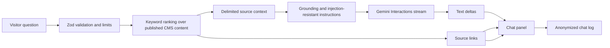

# Grounded assistant flow

The current retrieval path ranks published profile, project, skill, experience, certification, award and beyond entries by keyword overlap. Project routes restrict retrieval to that project. If the Gemini key is absent, a deterministic reply points to the closest published source. The assistant is disabled by default in its Payload global.

Embedding chunk storage exists in the Payload schema, but automatic chunk creation, Gemini embedding calls, similarity retrieval, publish hooks and a re-index command have not been implemented yet. Until that pipeline is added, the keyword retriever is the source of context.
