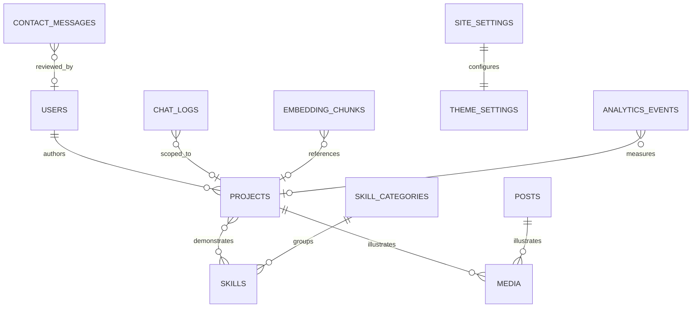
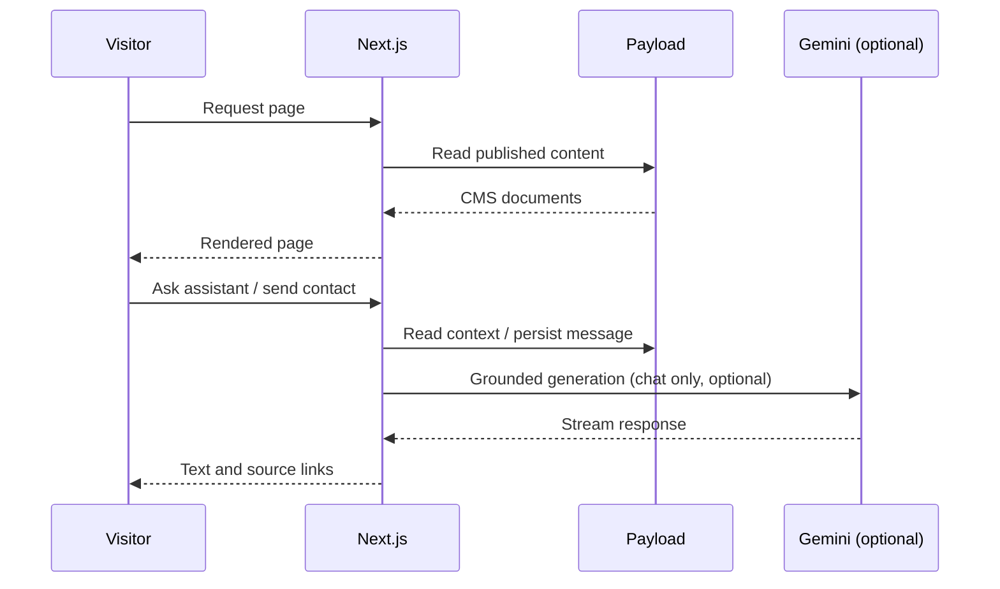

# Data model and request paths

Payload is the editing boundary. Public reads use published content, while owner changes go through the authenticated `/admin` panel.

`Projects` store portfolio identity and a sequence of typed slide blocks. Other public collections store skills, experience, certifications, awards, writing and beyond-the-code entries. Globals store identity, section visibility/order, theme, contact behavior, resume mode and AI configuration. Contact messages, chat logs and analytics events are write-only from public routes and readable only by the owner.

## Request flow

